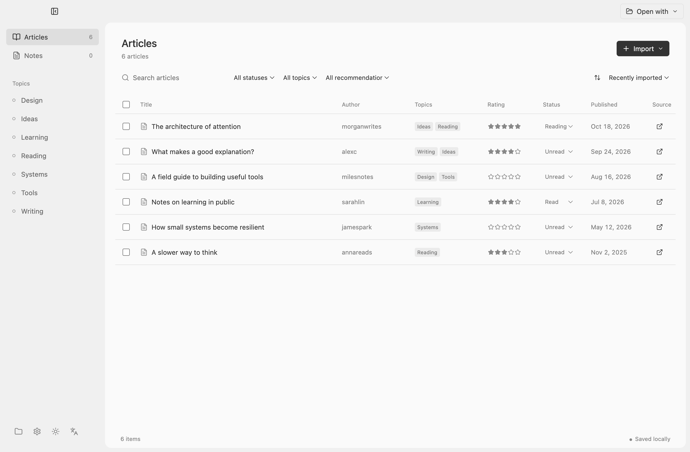
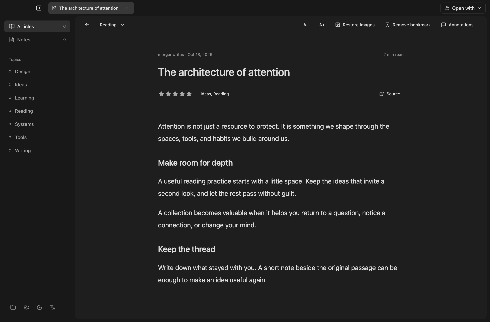

#  Folio

A local reading library for the X Articles you saved and haven't had time to read.

English · [简体中文](README.zh-CN.md)



*Screenshots use example content.*

Folio saves articles as Markdown on your computer. Browse and annotate them in the app, open the same folder in tools such as Obsidian or Cursor, or use your own AI tools to organize the files. Importing and reading do not require an AI API key.

## What you can do

- Import confirmed X Articles from your bookmarks without navigating or refreshing your X tabs. Short posts, videos, and unconfirmed items are skipped.
- Browse articles by topic and reading status, rate them, and add annotations alongside the original Markdown.
- Save article images locally. For older imports, use **Restore images** in the reader to recover images when their positions can be matched safely.
- Choose to remove an imported article from your X bookmarks. Its local copy stays in your library.
- Organize selected articles into topic notes and cards, and review suggested topics and reading recommendations before saving them. This optional feature uses your own model API key.
- Use the interface in English or Chinese, with light, dark, or system appearance.



## Get started

Folio is currently a macOS Apple Silicon preview. To build and run it from source, install Node.js 22 or later, then run:

```sh
npm install
npm run build
npm start
```

To build a macOS Apple Silicon zip, run `npm run package`. The preview is not signed or notarized. macOS may ask you to allow it in **Privacy & Security** on first launch.

Your library contains ordinary Markdown files and local image assets. Use the folder icon at the bottom of the sidebar to choose a library folder. Settings are stored in `~/Library/Application Support/Folio`.

## Import X bookmarks

Folio uses a Chrome extension to access the X session in your chosen Chrome profile. It makes requests in the background and does not open, navigate, or refresh X tabs.

1. Sign in to X in Chrome. In Folio, select **Import → Import X bookmarks**.
2. Choose **Install extension**, then **Copy folder path**.
3. Open `chrome://extensions` in the same Chrome profile and enable **Developer mode**.
4. Click **Load unpacked**. In the folder picker, press `⌘ Shift G`, paste the copied path, and press Return. Click **Select** to load the entire `extension` folder.
5. Return to Folio and click **Copy pairing code**. Open Folio from Chrome's extensions menu, paste the code, and click **Connect**.

If the extension is already installed, choose **Already installed** at step 2. Pair it again after restarting Folio. After updating Folio, refresh the extension in `chrome://extensions`. If its folder moved, remove the old extension and load the new folder.

## Use AI to organize articles

In **Settings**, choose a provider, model, and API key. Select articles in the library and click **Organize selected**. Folio shows proposed topics, reading recommendations, and draft notes or cards for review before saving them.

Folio sends selected article content directly to your chosen model provider when you start an AI task. Annotations are included only if you opt in. The API key is encrypted with the system's secure storage. Model output can be wrong or out of date, so check the source before relying on it.

## Privacy and limitations

Articles, notes, and image assets stay in your local library. Import and reading work without a model API key. The browser extension retains X cookies and CSRF values inside Chrome, and the pairing connection listens on a random local port.

X's web interface is not a stable public API. Its responses can change, reject requests, or omit articles. Article conversion may not preserve every format, link, or embedded item. Image recovery only inserts images where Folio can match their position in the existing text. Bookmark removal is sent only after you choose it and the connected X account matches the library. Image recovery and bookmark removal have been tested with simulated X responses, but not yet against a real account.

## Development

```sh
npm run typecheck
npm test
```

The extension's GraphQL operations and feature flags are adapted from [OpenCLI](https://github.com/jackwener/OpenCLI) under Apache-2.0. See [the extension README](extension/README.md) for details and attribution.

Folio is licensed under [Apache-2.0](LICENSE).
