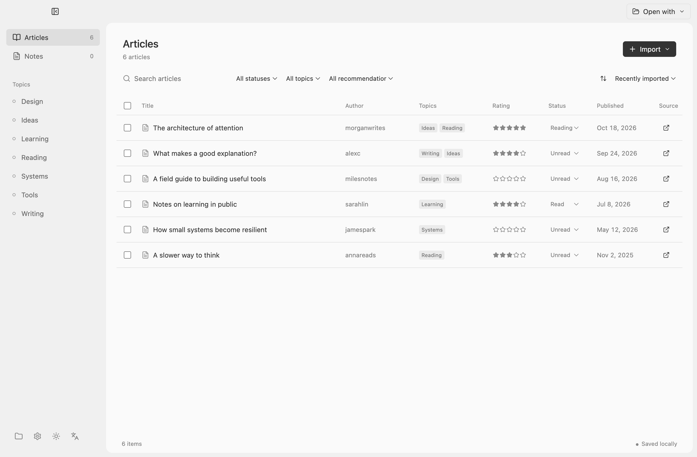
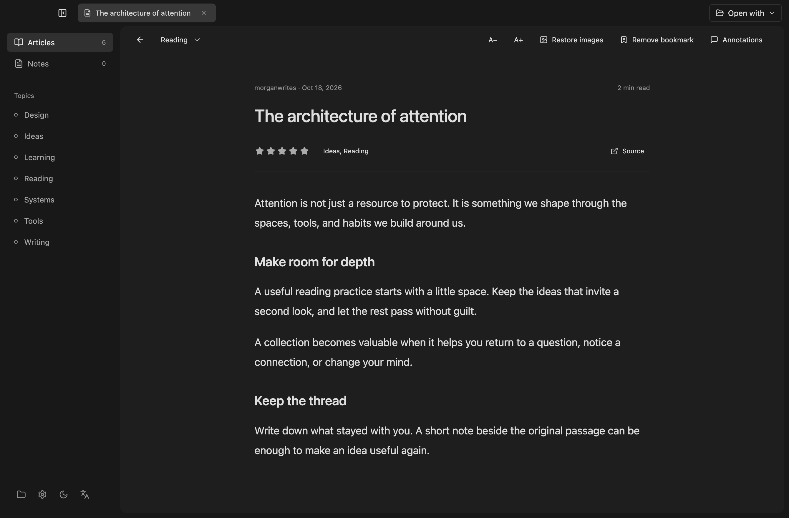

# Folio

[English](README.md) · 简体中文

*截图使用示例内容。*

Folio 是本地文章阅读器。文章和笔记以 Markdown 保存在你的资料库中。它支持中文、英文以及浅色、深色和跟随系统的界面。

## 安装与使用

解压 macOS Apple Silicon 安装包并打开 Folio。这个预览版本未签名或公证，首次打开可能需要在系统“隐私与安全性”中允许。应用设置位于 `~/Library/Application Support/Folio`；可以在左下角选择其他资料库。

## 从 X 导入

Folio 使用自己的 Chrome 扩展，不再调用 OpenCLI。扩展在后台请求 X，不创建、刷新或导航任何 X 标签页。它使用当前 Chrome 用户配置中已登录的 X 会话。首次使用请：

1. 在 Folio 中选择“导入”再选择“从 X 收藏导入”。
2. 选择“安装扩展”，然后点击“复制文件夹路径”。在已登录 X 的 Chrome 用户配置中打开 `chrome://extensions`，开启右上角的开发者模式。
3. 点击“加载已解压的扩展程序”。在文件夹选择窗口中按 `⌘ Shift G`，粘贴刚才复制的路径并按回车，再点击“选择”。选中的是整个 `extension` 文件夹，不是里面的文件。
4. 回到 Folio，点击“复制配对码”。在 Chrome 工具栏点击拼图形状的扩展程序按钮，打开 Folio 扩展，粘贴配对码并连接。每次重启 Folio 后需要重新配对。

配对连接仅监听本机随机端口，并使用一次性密钥。Cookie 和 CSRF 值留在 Chrome。扩展只允许读取收藏及 Article；仅在用户主动选择“取消收藏”时，才向 X 发送该文章的取消收藏请求。扩展不允许任意地址或页面导航。先按收藏的原始数据识别 Article，仅请求已确定的文章；其他及无法确定的条目跳过。暂停会中断可取消的请求，已保存文章保留。

**当前限制：**X 的网页接口没有公开稳定协议。X 的接口和文章标记可能变化、被拒绝或漏掉部分文章。本次新增的补图和取消收藏尚未用真实账号验证。正文转换也不保证保留所有格式、链接和嵌入媒体。失败时 Folio 会停止，不会自动回退到页面导航。用户可主动取消单篇文章在 X 的收藏，已保存的本地文章不会删除；该操作需要当前 X 账号与资料库一致。旧版扩展需要在 Chrome 扩展管理页面点击刷新。

## 隐私

导入及阅读不需要模型 API Key。主动选择整理文章时，所选内容会发送至你选择的模型服务商；个人批注默认不发送。AI 建议需要审阅后才保存，不能代替对原文和时效性的判断。API Key 使用系统安全存储加密。

## 开发

需要 Node.js 22 或更新版本。运行 `npm install`、`npm run build` 和 `npm start`。`npm run typecheck` 与 `npm test` 运行检查，`npm run package` 生成 macOS Apple Silicon 安装包。

扩展的固定 GraphQL 操作和功能参数参考 OpenCLI，遵循 Apache-2.0。请参阅 `extension/README.md`。外部工具同时写入资料时应用会检测部分冲突，仍建议备份重要资料。

## 图片与阅读建议

新版导入会将 X 文章图片保存到资料库的 `assets` 文件夹。对于早期导入的文章，可先连接扩展，再在阅读器点击“补全图片”。Folio 只在正文位置可以匹配时插入图片，保留原文和批注。

选中文章后点击“整理所选”，可以审阅主题、细读建议和卡片，再选择是否保存。已有主题、星级和阅读状态会保留。
